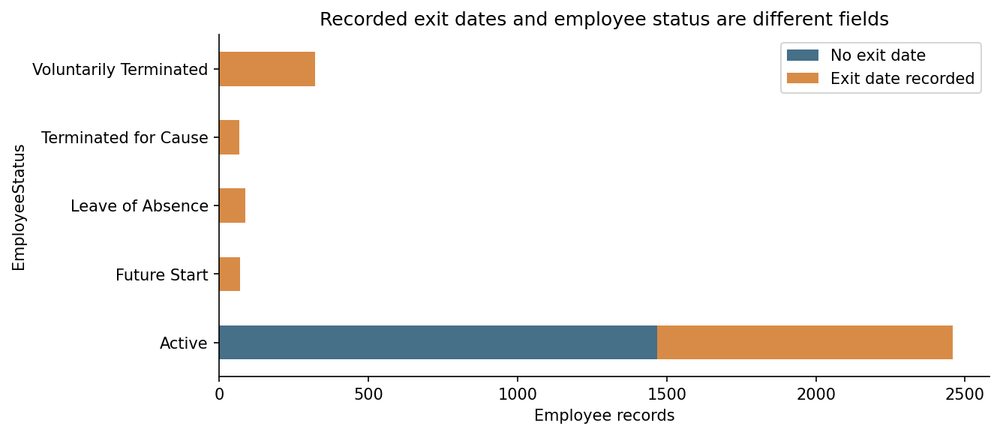
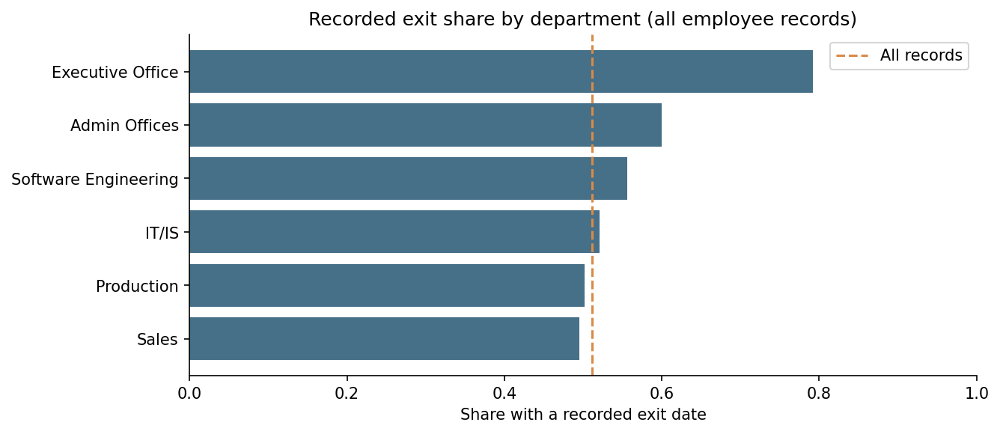
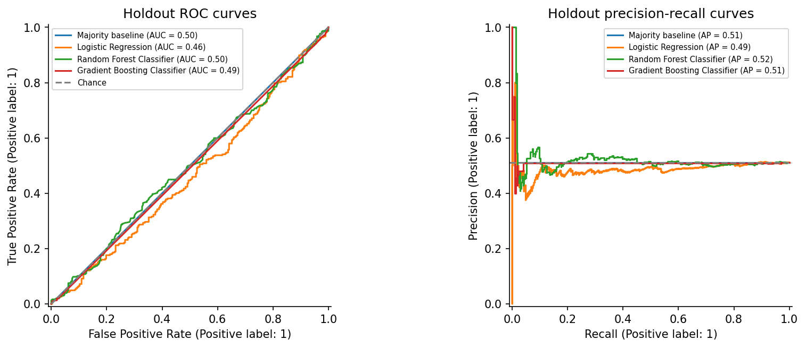
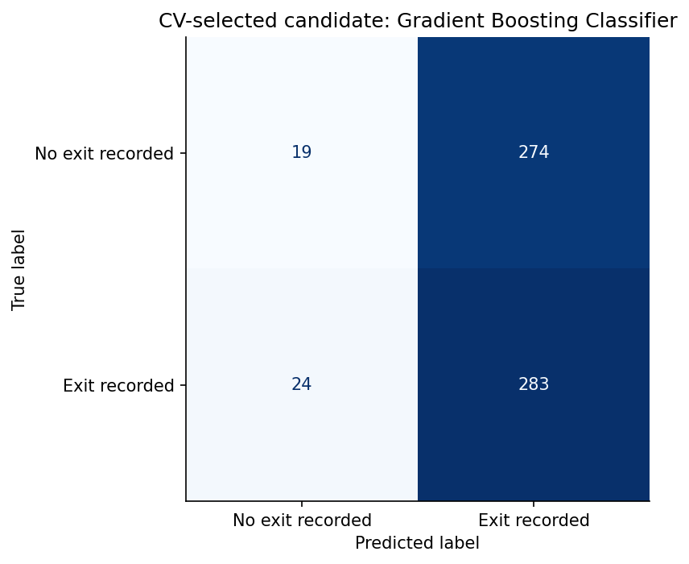
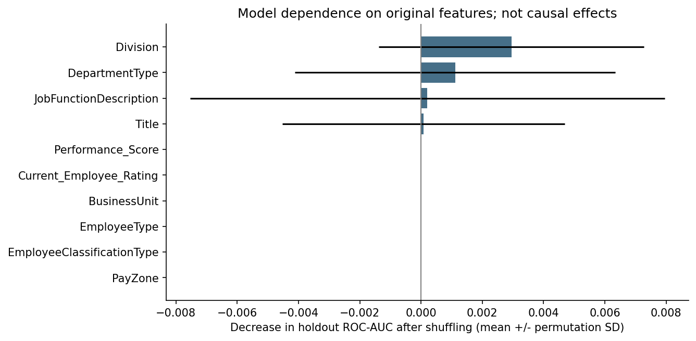

AI-Powered Workforce Analytics & Attrition Analysis

**Analyzing 3,000 employee records to audit recorded exits, compare workforce patterns, and evaluate machine learning models.**

The data contains **1,533 employees with a recorded exit date (51.1%)**, including **991 employees whose status is still Active**. A reproducible Jupyter Notebook audits that inconsistency and compares logistic regression, random forest, and gradient boosting with a majority baseline. The strongest nonbaseline candidate by training cross-validation achieved a holdout ROC-AUC of **0.491**, showing that useful predictive performance has not been established.

**[Explore the raw dataset](employee_data.csv)** | **[Explore the cleaned dataset](employee_data_cleaned.csv)** | **[Open the Jupyter Notebook](workforce_machine_learning%20%281%29.ipynb)** | **[View model results](#model-evaluation)**

## Business Problem

Understanding employee exits can support workforce planning and guide further investigation. Before building a retention model, the business needs a consistent outcome definition and evidence that the available features contain useful predictive signal.

> What do the recorded employee exits reveal about workforce patterns, how reliable are the outcome labels, and can the documented employee features classify those outcomes better than a baseline?

The analysis uses **employee_data_cleaned.csv**, supported by the raw dataset, preprocessing recipe, saved model outputs, and reproducibility reports. Each row represents one employee record. The notebook accounts for **all 19 source CSV files** without changing their original contents.

The target, **recorded_exit**, equals **1 when ExitDate is populated and 0 otherwise**. It describes an existing record. A prediction date and future outcome window have not been defined, so this project does not establish future attrition forecasting.

## Results at a Glance

| Metric | Result |
| --- | ---: |
| Employee records analyzed | 3,000 |
| Unique employee identifiers | 3,000 |
| Employees with a recorded exit date | 1,533 |
| Employees without a recorded exit date | 1,467 |
| Overall recorded-exit share | 51.1% |
| Active employees with a recorded exit date | 991 |
| Approved model predictors | 10 |
| Training / holdout records | 2,400 / 600 |

Recorded-exit share is **the number of records with a nonempty ExitDate divided by the number of records in the relevant group**. It is not an annualized attrition rate.

### Employee Status and Recorded Exits

| Employee status | Employee records | With an exit date | Without an exit date |
| --- | ---: | ---: | ---: |
| Active | 2,458 | 991 | 1,467 |
| Voluntarily Terminated | 321 | 321 | 0 |
| Leave of Absence | 86 | 86 | 0 |
| Future Start | 69 | 69 | 0 |
| Terminated for Cause | 66 | 66 | 0 |

The **991 Active/exit-date disagreements represent 33.0% of all records**. They are flagged for review, not automatically relabeled. A sensitivity definition based on **EmployeeStatus != Active** identifies **542 records (18.1%)**, but includes leave and future starters and is not substituted as the attrition target.

### Recorded Exits by Department

| Department | Employee records | Recorded exits | Recorded-exit share |
| --- | ---: | ---: | ---: |
| Executive Office | 24 | 19 | 79.2% |
| Admin Offices | 80 | 48 | 60.0% |
| Software Engineering | 115 | 64 | 55.7% |
| IT/IS | 430 | 224 | 52.1% |
| Production | 2,020 | 1,014 | 50.2% |
| Sales | 331 | 164 | 49.5% |

These comparisons describe the supplied snapshot. Department sizes differ substantially, and groups may have different observation periods. The Executive Office estimate comes from only **24 employees**.

**Business takeaway:** Resolve the outcome-definition inconsistencies before using model scores to prioritize employees. Department patterns can guide data review and business questions, but the current models perform near chance and do not justify individualized retention decisions. No retention improvement or financial savings are claimed.

## Visualizations

### 1. Recorded Exit Dates Versus Employee Status

[View the full-size target audit](target_status_audit.png)

**Interpretation:** The Active group contains both **1,467 records without an exit date** and **991 with an exit date**. Status and exit-date presence cannot be treated as interchangeable outcome definitions.

### 2. Recorded Exits by Department

[View the full-size department comparison](department_recorded_exits.png)

**Interpretation:** Executive Office has the highest observed share (**79.2%**), while Sales has the lowest (**49.5%**). The dashed line marks the overall **51.1%** share. These are descriptive differences, not evidence that a department causes exits.

### 3. Model Performance Versus a Majority Baseline

[View the full-size ROC and precision-recall comparison](holdout_roc_precision_recall.png)

**Interpretation:** Holdout ROC-AUC ranges from approximately **0.464 to 0.497** across the trained models, compared with **0.500** for the baseline. Average precision is also close to the holdout positive-class share of **51.2%**. The curves do not demonstrate useful discrimination.

### 4. Gradient Boosting Confusion Matrix

[View the full-size confusion matrix](selected_candidate_confusion_matrix.png)

**Interpretation:** At a fixed **0.5** probability threshold, gradient boosting identifies **283 recorded exits**, misses **24**, and incorrectly flags **274 records without an exit date**. Its **92.2% recall** comes with **50.8% precision**; high recall alone does not establish a useful model.

### 5. Permutation Feature Importance

[View the full-size feature diagnostic](permutation_importance.png)

**Interpretation:** Shuffling Division and DepartmentType produces small average AUC decreases, with substantial variation across permutations. Given the model's near-chance performance, these rankings are weak evidence about business drivers and do not establish causal effects. Error bars show permutation standard deviations, not confidence intervals.

All five charts come from the validated notebook workflow. Keep all five PNG files in the **same folder as README.md** so the image links render on GitHub.

## Approach & Tools

**Analysis environment:** Python and Jupyter Notebook. **Data checks and statistics:** pandas, NumPy, and SciPy. **Machine learning:** scikit-learn. **Visualization:** Matplotlib; the repository notebook also includes a Seaborn comparison chart.

1. **Verify the inputs:** Check all 19 original CSVs against the notebook's pinned repository snapshot and validate employee identifiers, record counts, and predictor completeness.
2. **Audit the outcome:** Derive recorded_exit from ExitDate presence, compare it with EmployeeStatus, and flag disagreements without changing source values.
3. **Explore workforce patterns:** Recalculate organizational exit shares, category support, and association summaries.
4. **Audit saved results:** Recompute the original holdout metrics from saved predictions and reconcile repeated benchmark, influence, and reproducibility reports.
5. **Build model pipelines:** Use nine categorical predictors and one numeric predictor, with preprocessing learned inside each training fold.
6. **Evaluate and interpret:** Compare fixed model candidates with a baseline, select a candidate using training CV, then examine holdout performance, uncertainty, and permutation importance.

The approved predictors are **Title, BusinessUnit, EmployeeType, PayZone, EmployeeClassificationType, DepartmentType, Division, JobFunctionDescription, Performance_Score, and Current_Employee_Rating**.

Rare categories in **Title, Division, and JobFunctionDescription** are grouped using training-fold counts below **10**, followed by one-hot encoding. The numeric rating is standardized for logistic regression. No oversampling or synthetic employee records are used.

**ExitDate, EmployeeStatus, termination fields, and outcome-related missingness flags are excluded from model inputs.** Identifiers and personal fields are also excluded from the approved feature set. They remain unchanged in the source datasets.

### Model Evaluation

| Model | Training CV ROC-AUC | Holdout ROC-AUC | Holdout accuracy | Holdout F1 |
| --- | ---: | ---: | ---: | ---: |
| Majority baseline | 0.500 | 0.500 | 51.2% | 0.677 |
| Logistic regression | 0.486 | 0.464 | 47.7% | 0.500 |
| Random forest | 0.498 | 0.497 | 49.5% | 0.520 |
| **Gradient boosting** | **0.503** | **0.491** | **50.3%** | **0.655** |

These are **new notebook-run results**, not the original benchmark CSV's scores. The supplied notebook's displayed run agrees with the locally validated run at the precision shown.

The split is **80% training / 20% holdout**, stratified with **seed 42**. Five-fold shuffled stratified cross-validation is performed on the training set only. Gradient boosting is the strongest nonbaseline candidate by mean training CV ROC-AUC; the holdout does not select the candidate. Saved project hyperparameters are reused, so these CV scores are not a nested evaluation of the earlier hyperparameter search.

| Gradient boosting metric | Holdout result | What it measures |
| --- | ---: | --- |
| ROC-AUC | 0.491 | Ranking of recorded exits versus records without exit dates |
| Precision | 0.508 | Share of flagged records that have an exit date |
| Recall | 0.922 | Share of recorded exits flagged at threshold 0.5 |
| F1-score | 0.655 | Balance between precision and recall |
| Average precision | 0.509 | Precision-recall summary across thresholds |
| Conditional 95% bootstrap ROC-AUC interval | 0.467–0.516 | Holdout resampling uncertainty for this fitted model |

The bootstrap interval uses **1,000 resamples of existing holdout record indices** and includes **0.500**, the chance reference. It does not account for training variability, previous model selection, or dataset shift. The majority baseline predicts the more common recorded-exit class for every employee; its relatively high recall and F1 demonstrate why those metrics must be interpreted alongside ROC-AUC and precision.

## Data Validation

| Validation check | Result | What it establishes |
| --- | ---: | --- |
| Raw / cleaned employee records | 3,000 / 3,000 | The cleaned file retains the source record count |
| Unique employee identifiers | 3,000 | No duplicated employee IDs |
| Duplicate full cleaned rows | 0 | No identical full-row duplicates |
| Empty cells across approved predictors | 0 | All ten model inputs are populated |
| Recorded exits / no recorded exit | 1,533 / 1,467 | Target balance matches the source audit |
| Raw-to-clean ID order and exit presence | Match | Cleaning preserves record alignment and exit indicators |
| Nonempty dates that fail parsing | 0 | Supplied StartDate, ExitDate, and DOB values parse in the audit |
| Active status with a recorded exit date | 991 | An unresolved consistency issue is explicitly surfaced |
| Original source CSVs | 19 verified | Source contents match their pinned Git blob identifiers |
| Original holdout predictions | 1,800 rows; 600 employees per model | Published test metrics can be independently recalculated |
| Locally validated notebook execution | 18 code cells; 0 errors | The original 37-cell notebook completes end to end |
| Repeated selected-model CV | Matches within 1e-12 | The fixed-seed reconstruction is repeatable |

The repository notebook now includes additional cells and charts. The **18-cell execution check** refers to the original notebook's code cells; all **19 source CSVs** remain the data and report inputs. Record completeness and successful execution do not resolve contradictory outcome fields or establish future predictive performance.

## Recommended Retention & Data Experiments

| Business priority | Proposed test or investigation | Outcome to measure |
| --- | --- | --- |
| Establish a consistent exit definition | Reconcile the 991 Active/exit-date cases with the source system and document status-update rules | Confirmed outcome labels and unresolved-case count |
| Understand departmental patterns | Review comparable employee cohorts with documented observation periods and group sizes | Exit shares and uncertainty under a consistent definition |
| Evaluate retention support | After outcome validation, randomize an eligible onboarding or manager-support intervention | Future retention versus a control group over a defined window |
| Assess future predictive value | Set a prediction date, collect pre-outcome features, and evaluate on a later independent period | ROC-AUC, precision-recall performance, and calibration versus baselines |

These are proposed next steps. The project does not report implemented interventions, improved employee retention, or realized financial savings.

## Limitations & Next Steps

- **Outcome consistency:** EmployeeStatus and ExitDate disagree for 991 Active records; the correct source-system interpretation still needs confirmation.
- **Observation window:** A shared snapshot cutoff and comparable time at risk have not been established. Recorded-exit shares are not annualized attrition rates.
- **Predictive signal:** The evaluated models perform near chance and do not demonstrate reliable employee-level risk ranking.
- **Previously analyzed holdout:** The reconstructed holdout contains the same 600 employees as the saved predictions, so it is not an external validation set.
- **Association versus causation:** Department differences and model importance values do not establish causes of employee exits.
- **Sparse groups:** Some job titles and job-function categories contain very few employees; their apparent patterns may be unstable.
- **Reproducibility scope:** The notebook is a documented reconstruction. The original training script and exact original fold fingerprints are unavailable; logistic regression uses an explicit liblinear solver assumption.
- **Original versus reconstructed results:** The documented rare-category treatment, solver assumptions, and runtime can produce differences from saved benchmark scores. The README reports the new notebook results and keeps the original exports separately linked.

## Project Files

| File | Contents |
| --- | --- |
| [Raw dataset](employee_data.csv) | 3,000 original employee records and 26 columns |
| [Cleaned dataset](employee_data_cleaned.csv) | 3,000 employee records and 28 columns used by the workflow |
| [Jupyter Notebook](workforce_machine_learning%20%281%29.ipynb) | Executed analysis, source checks, model training, evaluation, and interpretations |
| [Approved feature support](approved_feature_support.csv) | Completeness, category counts, and sparse-level support |
| [Preprocessing recipe](employee_attrition_preprocessing_recipe.csv) | Target definition, ten approved predictors, and leakage controls |
| [Target audit](employee_attrition_target_audit.csv) | Employee status versus exit-date presence |
| [Employee status summary](employee_status_attrition_summary.csv) | Status totals and alternative outcome definitions |
| [Organizational exit comparison](exit_rates_by_organisation_lens.csv) | Recorded-exit shares by business unit, department, division, and title |
| [Association summary](relationships_attrition_summary.csv) | Cramer's V and category-level support summaries |
| [Original model benchmarks](employee_model_benchmark_results.csv) | Saved parameters, CV scores, and original test metrics |
| [Original holdout predictions](employee_model_predictions_holdout.csv) | Saved predictions for three models across 600 employees |
| [Original feature influence](employee_feature_influence_summary.csv) | Encoded-feature influence values from the original models |
| [Exact feature support](feature_influence_exact_support.csv) | Raw category support attached to influence values |
| [Feature influence comparison](feature_influence_comparison.csv) | Corrected support and influence comparison |
| [Benchmark reconciliation](corrected_benchmark_reconciliation.csv) | Original metric consistency comparisons |
| [Near-tie metric summary](near_tie_metric_summary.csv) | Original models' close performance comparisons |
| [Stability and overfitting summary](stability_overfitting_summary.csv) | Original fold variation and train-to-validation gaps |
| [End-to-end reproducibility audit](reproducibility_end_to_end_audit.csv) | Source pipeline and provenance limitations |
| [Corrected cause report](reproducibility_cause_report_corrected.csv) | Supported and unresolved explanations for reproducibility differences |
| [Final reproducibility report](reproducibility_final_report.csv) | Saved controlled rerun comparisons |
| [New CV results](results/new_cv_results.csv) | Reconstructed models' training-only cross-validation scores |
| [New holdout results](#model-evaluation) | Fresh holdout metrics used in this README |
| [Validated run manifest](results/run_manifest.json) | Data snapshot, runtime versions, features, split fingerprint, and uncertainty results |
| [Status/exit visualization](target_status_audit.png) | Stacked employee counts illustrating label disagreements |
| [Department visualization](department_recorded_exits.png) | Department-level exit-date shares |
| [Model performance visualization](holdout_roc_precision_recall.png) | ROC and precision-recall curves against a baseline |
| [Confusion matrix](selected_candidate_confusion_matrix.png) | Correct and incorrect classifications for gradient boosting |
| [Permutation importance visualization](permutation_importance.png) | Diagnostic dependence on original model features |
